<p align="center">
  
</p>

<h1 align="center">TidyFlow</h1>

<p align="center">
  Point it at a messy folder. It reads your files, proposes a clean set of folders,
  and sorts everything into a Library you keep using. New downloads get a suggested folder
  the next time you open it, and it learns from where you put things.
</p>

<p align="center">
  <a href="https://github.com/DEVJHAWAR11/Tidyflow/releases/latest"><b>Download for macOS</b></a>
  &nbsp;·&nbsp;
  <a href="https://github.com/DEVJHAWAR11/Tidyflow/releases/latest"><b>Download for Windows</b></a>
  &nbsp;·&nbsp;
  <a href="#run-from-source">Run from source</a>
</p>

<p align="center">
  <picture>
    <source media="(prefers-color-scheme: dark)" srcset="assets/screenshots/library-dark.png" />
    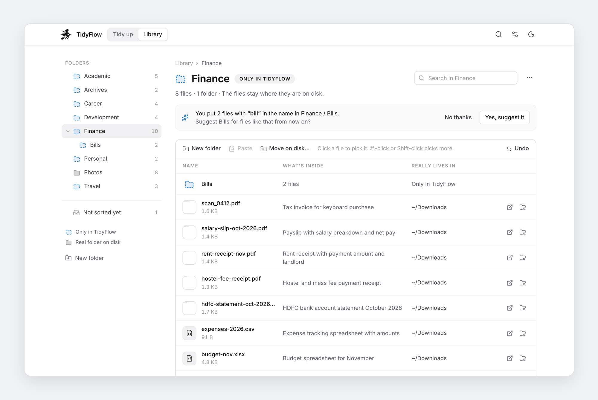
  </picture>
</p>

## Contents

- [The idea](#the-idea)
- [Tidy up a folder](#tidy-up-a-folder)
- [The Library](#the-library)
- [New since last time](#new-since-last-time)
- [It learns from you](#it-learns-from-you)
- [Search](#search)
- [What makes it different](#what-makes-it-different)
- [Privacy](#privacy)
- [How it works inside](#how-it-works-inside)
- [Install](#install) · [Run from source](#run-from-source) · [Build](#build) · [Command line](#command-line) · [Project layout](#project-layout)

## The idea

Most organizers are a one-time clean-up. You run them, the folder looks nice for a week, and then Downloads fills up again. TidyFlow is built around a loop instead:

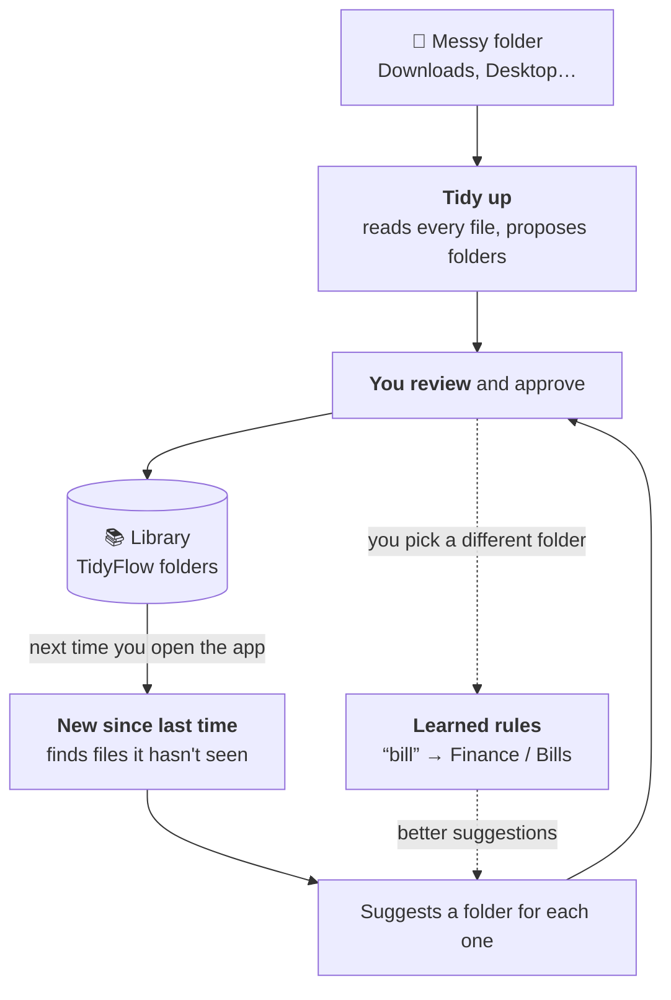

1. **Tidy up** a folder once. TidyFlow reads what's inside every file and proposes folders that fit *your* files.
2. Files land in the **Library**, in **TidyFlow folders**. By default nothing moves on disk; the Library remembers where each file belongs.
3. Each time you open TidyFlow, it looks for **new files** in the folders you tidied and suggests where they go.
4. When you put a file somewhere else than it suggested, it notices. After a couple of times it **offers a rule**, so the next suggestion is right.

## Tidy up a folder

<table>
  <tr>
    <td width="50%" valign="top">
      <picture>
        <source media="(prefers-color-scheme: dark)" srcset="assets/screenshots/home-dark.png" />
        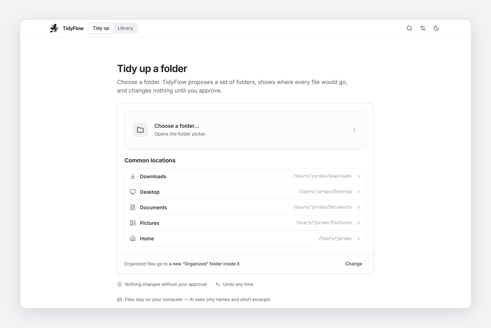
      </picture>
      <p><b>1. Pick a folder</b><br />Downloads, Desktop, Documents, or any folder you choose.</p>
    </td>
    <td width="50%" valign="top">
      <picture>
        <source media="(prefers-color-scheme: dark)" srcset="assets/screenshots/plan-dark.png" />
        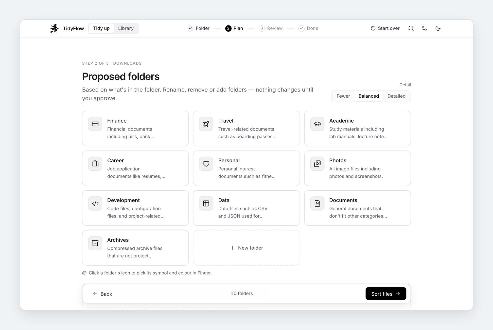
      </picture>
      <p><b>2. Agree on a plan</b><br />The folders come from your files. Make it simpler or more detailed, or ask for changes in plain English.</p>
    </td>
  </tr>
  <tr>
    <td width="50%" valign="top">
      <picture>
        <source media="(prefers-color-scheme: dark)" srcset="assets/screenshots/review-dark.png" />
        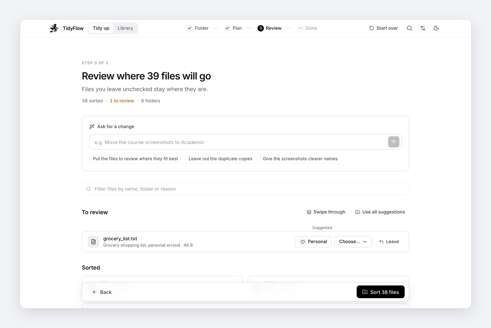
      </picture>
      <p><b>3. Review</b><br />Files it's sure about are already placed. The few it isn't sure about wait for you, with the reason for each guess.</p>
    </td>
    <td width="50%" valign="top">
      <picture>
        <source media="(prefers-color-scheme: dark)" srcset="assets/screenshots/done-dark.png" />
        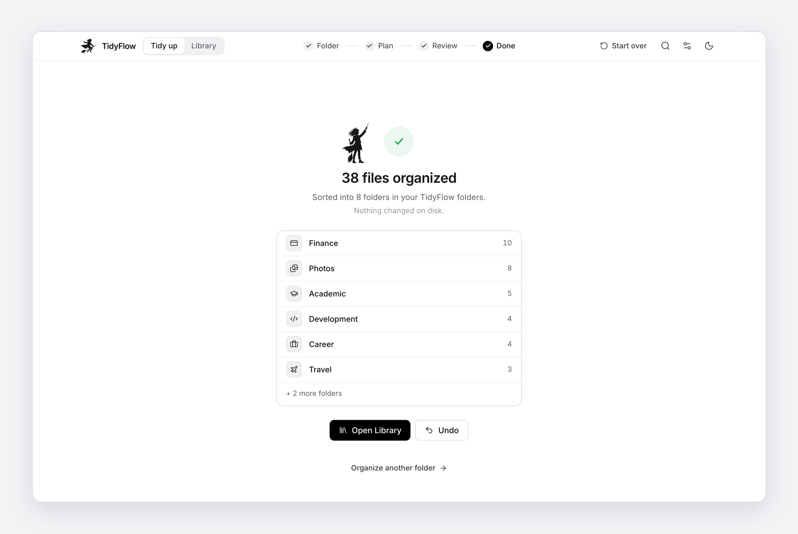
      </picture>
      <p><b>4. Done, and undoable</b><br />Open the Library to see the result, or press Undo to put everything back the way it was.</p>
    </td>
  </tr>
</table>

### Three ways to finish

<picture>
  <source media="(prefers-color-scheme: dark)" srcset="assets/screenshots/review-apply-dark.png" />
  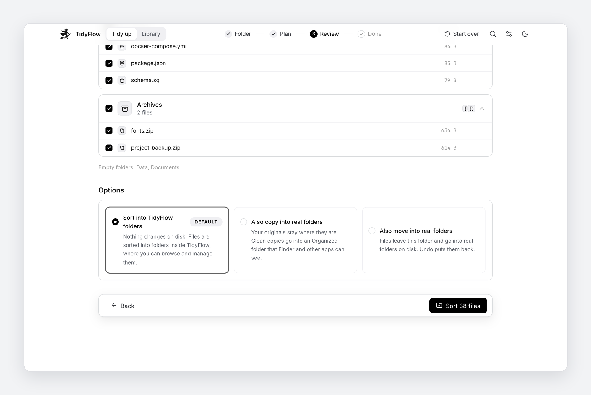
</picture>

| Option | What happens on disk | Good for |
| :-- | :-- | :-- |
| **Sort into TidyFlow folders** (default) | Nothing. Files stay where they are; the Library knows which folder each belongs to. | Trying it out, or folders other apps expect to stay put |
| **Also copy into real folders** | Clean copies go into an `Organized` folder. Every copy is checked with SHA-256. | Keeping originals while getting real folders in Finder or Explorer |
| **Also move into real folders** | Files move into real folders on disk. Undo checks each file's hash and moves it back. | A real clean-up of Downloads or Desktop |

Whichever you pick, the files also show up in the Library.

## The Library

The Library is a small file manager for your TidyFlow folders. It opens by default once you've tidied a folder.

<table>
  <tr>
    <td width="50%" valign="top">
      <picture>
        <source media="(prefers-color-scheme: dark)" srcset="assets/screenshots/library-dark.png" />
        
      </picture>
      <p><b>Only in TidyFlow</b> (dashed blue icon)<br />The folder lives in TidyFlow. Its files stay wherever they are on disk, and <i>Really lives in</i> shows where.</p>
    </td>
    <td width="50%" valign="top">
      <picture>
        <source media="(prefers-color-scheme: dark)" srcset="assets/screenshots/library-real-dark.png" />
        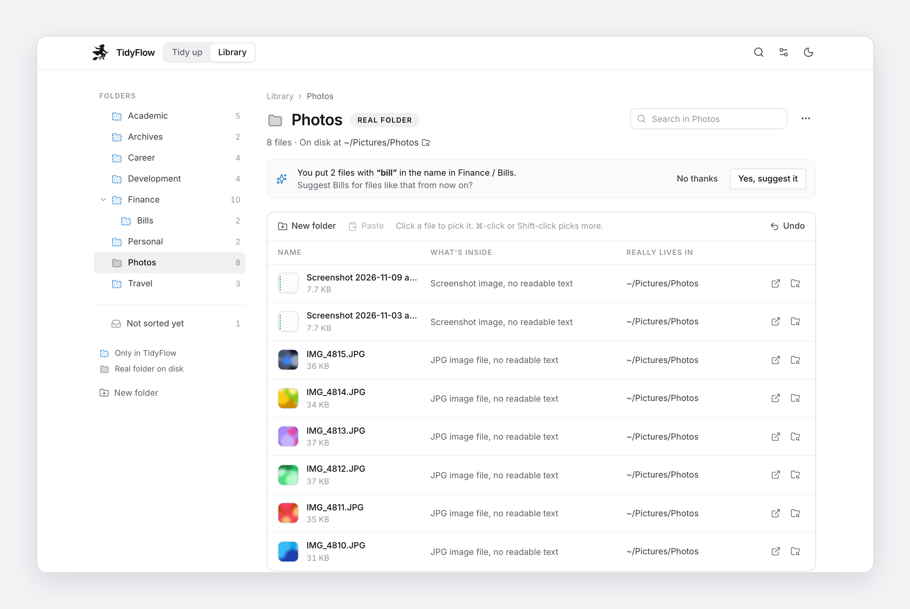
      </picture>
      <p><b>Real folder on disk</b> (solid grey icon)<br />Every file in it is also in one folder on disk, so Finder sees the same thing you do.</p>
    </td>
  </tr>
</table>

A file can be in more than one TidyFlow folder (copy and paste it into a second one), and files that aren't in any folder wait under **Not sorted yet**.

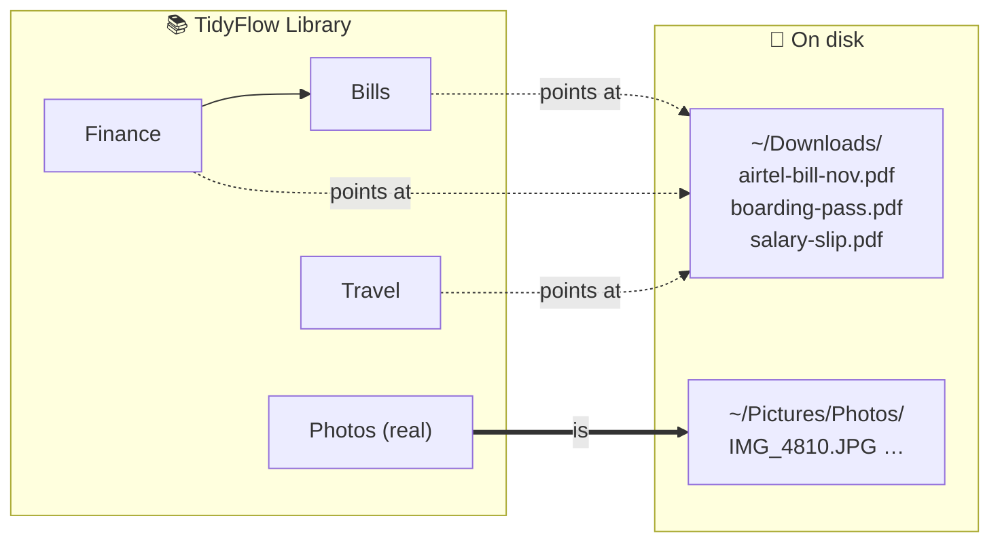

### What you can do

| Action | Touches disk? | Notes |
| :-- | :-: | :-- |
| New folder, rename or delete a TidyFlow folder | No* | A new folder goes inside the one you're in. Deleting a folder sends its files to *Not sorted yet*. *Renaming a real folder renames it on disk too |
| Cut, copy, paste between folders (⌘X ⌘C ⌘V) | No | Copy adds a file to a second folder; cut moves it |
| Remove from folder | No | The file goes back to *Not sorted yet* |
| Rename a file (↩) | Yes | Renames it in place; refuses if the name is taken |
| **Move on disk…** | Yes | Moves the picked files to a folder you choose, checking each one's hash |
| **Make it a real folder…** | Yes | Moves every file in the folder into one disk folder; if one fails, the ones already moved go back |
| Move to Trash (⌫) | Yes | Always the system Trash, never a permanent delete |
| Undo (⌘Z) | Back as it was | Several steps deep, newest first. A disk change is undone only if the file's hash still matches |

Anything that touches the disk asks first (except renaming a file). If you rename or move a file in Finder, TidyFlow follows it by its disk identity and then by its contents, so it keeps its folders.

## New since last time

TidyFlow doesn't run in the background. When you open it, or press **Check**, it looks in the folders you've tidied for files it hasn't seen before.

<table>
  <tr>
    <td width="50%" valign="top">
      <picture>
        <source media="(prefers-color-scheme: dark)" srcset="assets/screenshots/library-banner-dark.png" />
        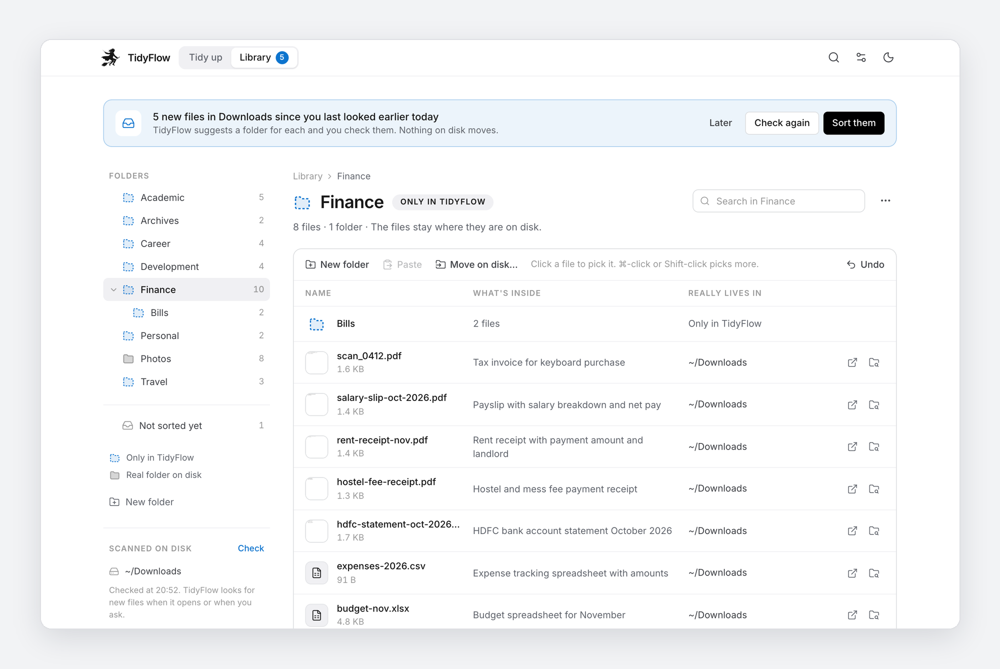
      </picture>
      <p><b>A banner tells you</b><br />with a count on the Library tab. <i>Later</i> hides it until the next check.</p>
    </td>
    <td width="50%" valign="top">
      <picture>
        <source media="(prefers-color-scheme: dark)" srcset="assets/screenshots/newfiles-dark.png" />
        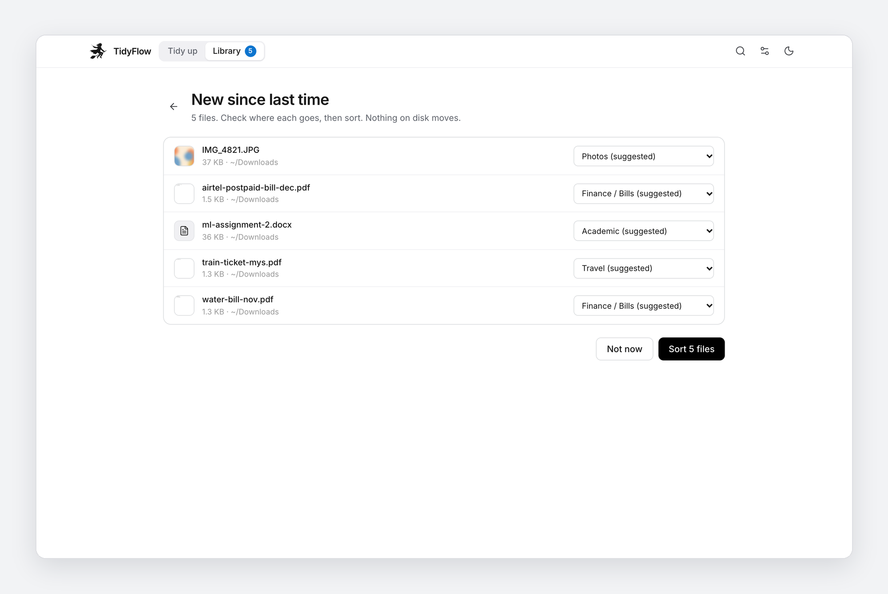
      </picture>
      <p><b>Each file gets a suggestion</b><br />from your own folders. Change any of them, then sort. Nothing on disk moves.</p>
    </td>
  </tr>
</table>

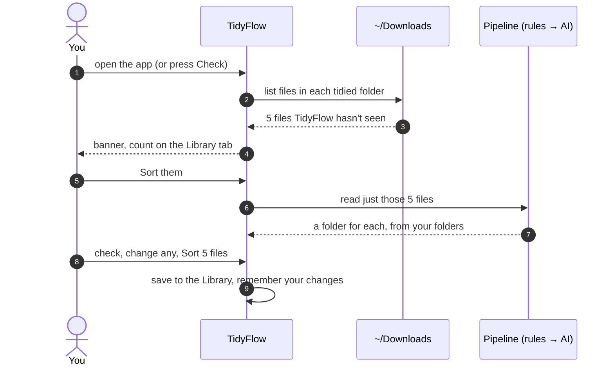

A file counts as new when it has never been seen, not because of its date, so unzipped files and old downloads with old timestamps still show up.

## It learns from you

When you put a file in a different folder than the one TidyFlow suggested, on the review screen, on the New files screen, or by cutting and pasting it in the Library, that's a **correction**. When two or more corrections into one folder share a word in their names, the Library offers a rule:

<picture>
  <source media="(prefers-color-scheme: dark)" srcset="assets/screenshots/rule-offer-dark.png" />
  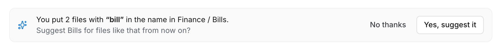
</picture>

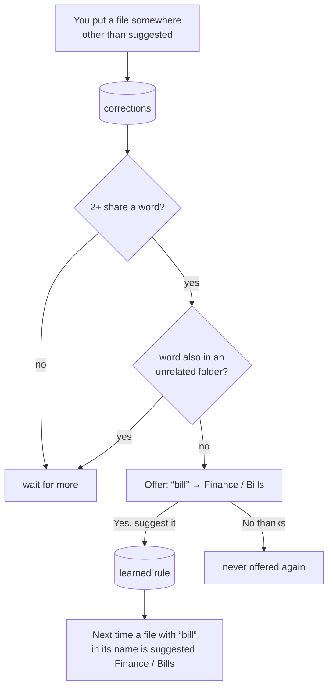

- Rules only **suggest** a folder. You still see and check every file.
- Dates, months, file types and filler words like *copy*, *final* or *scan* never become rules.
- A rule follows its folder if you rename or move the folder.
- Your rules are listed in **Settings → Library**, where **Forget** removes one (and Undo brings it back).

<picture>
  <source media="(prefers-color-scheme: dark)" srcset="assets/screenshots/settings-dark.png" />
  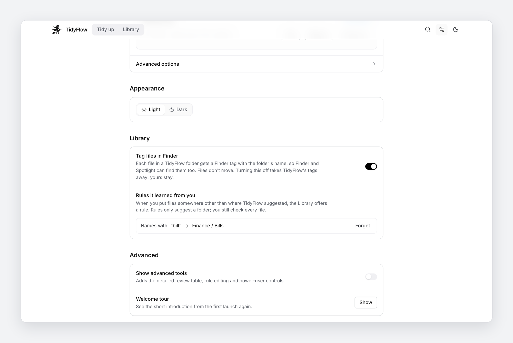
</picture>

### Finder tags (macOS)

Turn on **Tag files in Finder** and each file in a TidyFlow folder gets a Finder tag named after its folder, so Finder's sidebar and Spotlight can find a folder's files too. Files don't move. TidyFlow remembers which tags it added and only ever takes those away, so tags you added yourself stay.

## Search

Search looks through file names and the text inside documents, receipts and screenshots, including text read by OCR.

<picture>
  <source media="(prefers-color-scheme: dark)" srcset="assets/screenshots/search-dark.png" />
  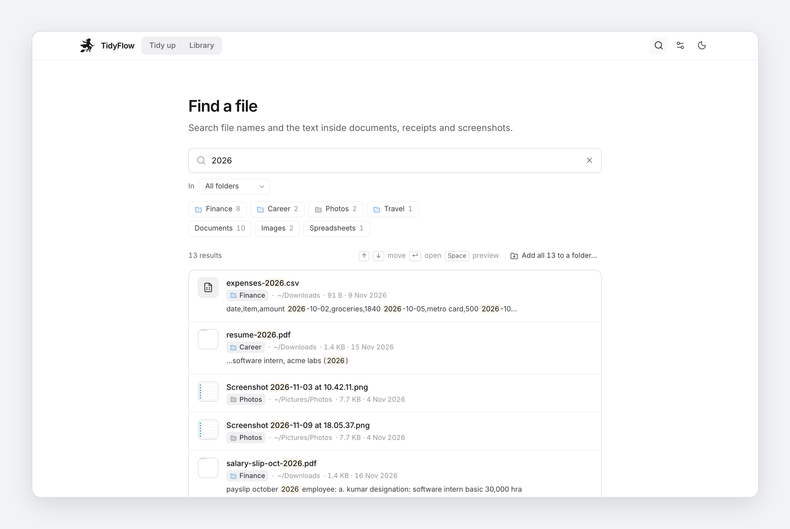
</picture>

- Filter by TidyFlow folder or file type, or limit the search with **In: All folders ▾**.
- Each result shows its folder and where it really lives on disk.
- **Add all to a folder…** puts every result into a TidyFlow folder in one go.
- The search box at the top of a Library folder searches just that folder.

### Search by meaning

Turn on **Settings › Search by meaning** and search also finds files that are about what you typed, even when they don't contain the words. "rent agreement" finds a tenancy contract, and "train ticket" finds a booking screenshot.

- It's off until you turn it on. Then you pick a model to download: **Standard** (EmbeddingGemma 2, 8-bit, 310 MB, recommended) or **Full precision** (558 MB). Downloads resume if they're interrupted and are checked against a SHA-256 before use.
- TidyFlow then builds a meaning index from the same text keyword search uses, one vector per file. A library of about 500 files with text takes about a minute on an Apple M4. After that, only files whose text changed are read again.
- Files found by meaning are listed after the files that contain your words, under **Related by meaning**. Only files that clearly stand out are shown, so a search for something you don't have shows none. **Add all to a folder…** only takes the files with your words.
- It runs on your computer: the model runs in a llama.cpp helper process that listens only on this machine with a fresh key, and stops after five idle minutes. **Remove model** deletes the model and the index.
- It reads the first few thousand characters of each file, like keyword search. Files with no text, like most photos, are still found by name.

## What makes it different

- **It reads the files, not just the names.** It reads text from PDFs, Office documents, code and spreadsheets, and uses on-device OCR for scans and screenshots (Apple Vision on macOS, PaddleOCR on Windows). So `scan_0412.pdf` ends up next to your other invoices.
- **The folders come from your files.** The plan is built from your actual files, not a fixed template, and the detail level runs from *Fewer* to *Detailed*.
- **It keeps working after the first sort.** The Library, new-file checks and learned rules turn a one-time clean-up into a habit.
- **Nothing happens until you approve.** By default nothing moves on disk at all. When files are copied or moved, each one is checked with SHA-256, and existing files are never overwritten.
- **Undo is real.** Every Library action can be undone, several steps back. Undo checks each file's hash before it changes anything on disk.
- **Duplicates are flagged.** That covers exact copies and near-identical images such as resized photos or repeat screenshots.
- **It works without AI.** With no API key it falls back to rules, your learned rules and file types. With a key, it uses the provider you pick: DeepSeek, OpenAI, Gemini, Groq, OpenRouter, or any OpenAI-compatible endpoint.

## Privacy

Your files stay on your computer, and so do the OCR and text extraction. If you connect an AI provider, only file names and short text excerpts are sent to classify them. Passwords, API keys and tokens are scrubbed from that text before it leaves. Without a key, nothing is sent anywhere. Search by meaning runs entirely on your computer too; its one network request is the model download from Hugging Face when you turn it on.

The Library, your learned rules and the undo history are kept in a local SQLite database. Finder tags are written to the files' own metadata on your Mac and nowhere else. Settings and keys live in your user data folder (`~/Library/Application Support/TidyFlow` or `%APPDATA%\TidyFlow`) and are readable only by you.

## How it works inside

TidyFlow is a local web app in a native window: a FastAPI server on your machine and a React UI.

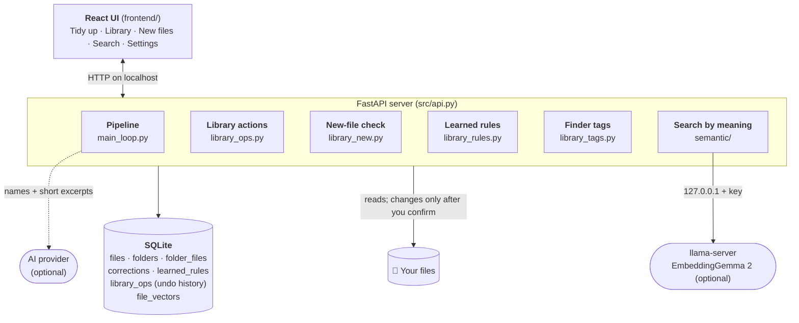

Each file goes through the same pipeline, whether it's part of a full tidy-up or one new download:

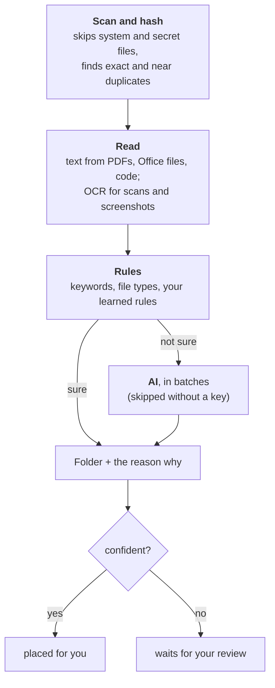

## Install

Grab the latest build from [**Releases**](https://github.com/DEVJHAWAR11/Tidyflow/releases/latest):

| Platform | File | |
| :-- | :-- | :-- |
| macOS | `TidyFlow.dmg` | Open it and drag TidyFlow into Applications |
| Windows 10/11 | `TidyFlow-windows.zip` | Unzip and run `TidyFlow.exe` |

On first launch, open **Settings** to add an AI key (optional). The builds aren't notarized yet, so on macOS right-click the app and choose **Open** the first time. On Windows, choose **More info → Run anyway**.

## Run from source

Requires Python 3.10+ and Node.js 18+.

```bash
git clone https://github.com/DEVJHAWAR11/Tidyflow.git
cd Tidyflow
python3 -m venv venv && source venv/bin/activate   # Windows: venv\Scripts\activate
pip install -r requirements.txt
npm --prefix frontend install && npm --prefix frontend run build
python3 desktop.py
```

`desktop.py` starts the local server and opens TidyFlow in a native window. Search by meaning needs llama.cpp's `llama-server`: run `python3 build/fetch_llama_server.py` to put the pinned build in `bin/llama/`, or have one on your `PATH` (for example `brew install llama.cpp`). To work on the UI with hot reload, run the backend and the Vite dev server side by side:

```bash
python3 -m uvicorn src.api:app --port 8000
npm --prefix frontend run dev        # http://localhost:1420
```

## Build

Everything needed to package the desktop app is in [`build/`](build):

```
build/
├── build.py          shared build script (frontend → OCR helper → llama-server → PyInstaller → installer)
├── fetch_llama_server.py   pinned llama.cpp release for search by meaning, put in bin/llama/
├── tidyflow.spec     PyInstaller spec
├── macos/build.sh    → dist/TidyFlow.app, dist/TidyFlow.dmg
└── windows/
    ├── build.ps1     → dist/TidyFlow/TidyFlow.exe, dist/TidyFlow-windows.zip
    └── build.bat     same, for Command Prompt or double-click
```

```bash
./build/macos/build.sh            # on a Mac
```

```powershell
.\build\windows\build.ps1         # on Windows
```

PyInstaller can't cross-compile, so each platform has to be built on that platform. Pushing a `v*` tag runs [`.github/workflows/build.yml`](.github/workflows/build.yml), which builds both and attaches them to the GitHub release. Pass `--skip-deps` to either script to skip the `pip install` step.

## Command line

The tidy-up pipeline is also available from the terminal:

```bash
python3 -m src.cli run -i ~/Downloads -o ~/Downloads/Organized          # dry run with an HTML report
python3 -m src.cli run -i ~/Downloads -o ~/Organized --auto-apply --confirm
python3 -m src.cli inventory -i ~/Downloads -o ./report                  # offline, no AI
python3 -m src.cli config-set-llm deepseek <your-key>
```

Defaults such as the confidence threshold, OCR, batch size and duplicate sensitivity live in [`config.yaml`](config.yaml).

## Project layout

```
src/              FastAPI server, classification pipeline, CLI
  scanner.py        file discovery and ignore rules
  extractor.py      text from PDFs, Office files, code
  ocr_engine.py     Apple Vision / PaddleOCR
  hashing.py        SHA-256 and perceptual-hash duplicates
  rules.py          keyword, file-type and learned rules
  llm_provider.py   batched AI classification
  ai_assistant.py   folder planning and plain-English edits
  applier.py        verified copy / move and undo
  database.py       SQLite index and full-text search
  library.py        TidyFlow folders and where each file lives
  library_ops.py    Library actions and multi-step undo
  library_new.py    "new since last time" and following moved files
  library_rules.py  rules learned from your corrections
  library_tags.py   Finder tags (macOS)
  semantic/         search by meaning: model download, llama-server helper, vectors, indexing
frontend/         React + TypeScript + Tailwind UI
  src/flow/         the Tidy up wizard
  src/components/   Library, Search, Settings
build/            desktop packaging for macOS and Windows
tests/            pytest suite
```

```bash
python3 -m pytest tests/
```
